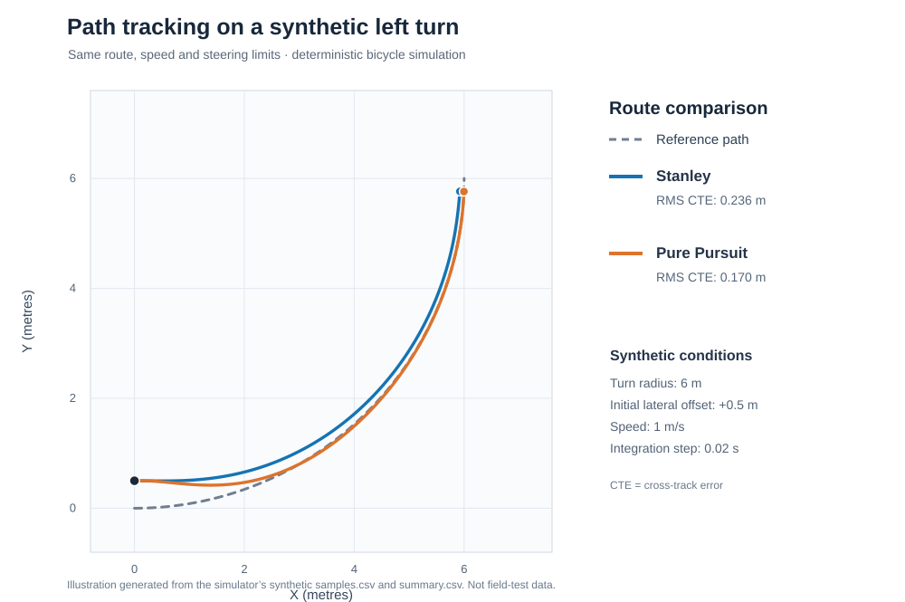

# Autonomous Tractor Navigation Simulation

A standalone C# toolkit for deterministic path tracking and controller evaluation.

Compare Stanley and Pure Pursuit on synthetic straight and curved routes using a constant-speed kinematic bicycle model with shared steering-angle and steering-rate constraints. Deterministic tests, evaluation metrics and CSV output make the comparisons reproducible. Every route and initial condition is synthetic; the results do not establish real vehicle performance or safety.



The diagram compares two nominal controllers on the same **synthetic** radius-6 m left turn with a +0.5 m initial lateral offset. Trajectory traces and RMS cross-track errors are produced by the simulator, not field measurements. The chart is regenerated and checked for byte-for-byte consistency in CI; it illustrates one scenario rather than a general controller ranking.

The project has no Unity, sensor, network, actuator, or external NuGet dependencies. Historical implementations and recorded data are excluded. New implementations use the mathematical sources acknowledged in [provenance](docs/PROVENANCE.md).

## Requirements and commands

Use the .NET **10.0.401 SDK** (target framework `net10.0`). `global.json` allows later patches in the same SDK feature band. Build and test commands below work from the repository root, including a clean export with no parent repository. The SDK contains every required dependency; `NuGet.Config` disables package sources because none are used.

```sh
dotnet restore NavigationSim.slnx --configfile NuGet.Config --locked-mode
dotnet build NavigationSim.slnx -c Release --no-restore
dotnet run --project tests/TractorNavigation.Tests -c Release --no-build
dotnet run --project src/TractorNavigation.Cli -c Release --no-build -- list
dotnet run --project src/TractorNavigation.Cli -c Release --no-build -- simulate --output artifacts/demo
```

The dependency-free test executable prints individual checks and passed/failed counts, and returns a nonzero status on failure. It is the test runner; use the command above rather than `dotnet test`.

On Bash systems, `bash scripts/validate.sh` also checks nine invalid CLI cases, explicit timeout and numerical-failure results, and byte-identical CSV files from two complete comparison runs. Each invocation creates a fresh ignored results directory. The root GitHub Actions workflow runs the same complete validation on Ubuntu 24.04 with the SDK selected by `global.json`; see the Actions tab for the current run status.

For a selected route/controller:

```sh
dotnet run --project src/TractorNavigation.Cli -c Release --no-build -- simulate \
  --scenario left-turn-offset --controller stanley --output artifacts/selected
```

The default comparison runs seven routes against four configurations: nominal Stanley and Pure Pursuit, Stanley with lower cross-track gain, and Pure Pursuit with a longer lookahead. `--controller stanley` or `pure-pursuit` selects its nominal configuration. Output directories must be empty or new; existing results are preserved.

Parameters `--speed`, `--duration`, and `--step` accept invariant-culture numeric values.

The runner permits at most one million integration steps per run. The CLI comparison additionally limits all selected runs to two million recorded samples to bound memory use.

A deliberately unfinished run still exports its results:

```sh
dotnet run --project src/TractorNavigation.Cli -c Release --no-build -- simulate \
  --scenario straight --controller stanley --speed 0 --duration 1 --output artifacts/stationary
# Expected exit: 2; summary.csv reports TimedOut.
```

Exit codes are 0 when every selected route completes, 2 for any timeout or simulation failure, 64 for invalid arguments, and 1 for output errors.

## Reproducing the trajectory figure

The checked-in SVG is generated directly from the simulator's synthetic CSV output using Python 3's standard library (no plotting packages needed):

```sh
dotnet run --project src/TractorNavigation.Cli -c Release --no-build -- simulate --output artifacts/chart-review
python3 scripts/plot_trajectories.py --samples artifacts/chart-review/samples.csv --summary artifacts/chart-review/summary.csv --output artifacts/chart-review.svg
cmp docs/images/tracking-comparison.svg artifacts/chart-review.svg
```

The SVG corresponds to the nominal Stanley and Pure Pursuit configurations in the `left-turn-offset` scenario. The reference arc comes from the same documented synthetic route equation as `RouteFactory.Arc`. CI checks that the committed SVG agrees with the simulator. These are simulated, not real-tractor trajectories.

## Modules and results

- `TractorNavigation.Core`: immutable route geometry, controllers, explicit-Euler bicycle dynamics, scenario catalog, simulation and evaluation.
- `TractorNavigation.Cli`: scenario selection, readable comparison output and invariant-culture CSV export.
- `TractorNavigation.Tests`: mathematical unit checks, controller checks, failure cases and deterministic integration tests.

`summary.csv` retains every selected run with status, failure reason, metrics, controller parameters in its name, and simulation settings. `samples.csv` contains every recorded initial and integrated state, requested/applied steering and rear-axle cross-track error. Numeric round-trip strings and LF line endings make identical runs comparable. Generated CSV files, binaries and caches are ignored.

RMS error is `sqrt(sum(e_i²) / N)`; maximum error is `max(abs(e_i))`. Here `e_i` is the signed perpendicular error of the rear axle against the nearest route segment, sampled at the initial state and after each integration step. Completion requires both endpoint proximity and route progress. Failure reasons and undefined numeric values remain explicit. Details are in [architecture](docs/ARCHITECTURE.md) and the [validation plan fixed before simulation](docs/VALIDATION_PLAN.md).

## Limits and review

This is a constant-speed, planar, no-slip kinematic model with sampled polylines, ideal state knowledge and deterministic steering limits. It omits tire/soil forces, slopes, actuator dynamics, sensing, latency, localization, collision checking and obstacle planning. The global nearest-point search is intended for simple nonintersecting routes. Steering feasibility does not guarantee route completion; compare statuses as well as errors.

Reproducibility is tested within the same SDK/runtime and architecture. Cross-platform floating-point byte identity and controller optimality are not promised. Numerical failure is a result, never a discarded run.

[Validation review](docs/PUBLICATION_REVIEW.md) records local and hosted validation provenance, comparison results, scope and limitations. [Export instructions](docs/EXPORT.md) describe the self-contained file allowlist and clean-export validation. Mathematical references and implementation adaptations are recorded in [provenance](docs/PROVENANCE.md).

## License

The [MIT License](LICENSE), copyright 2026 TohruSu, covers this standalone project's newly implemented source, tests and documentation. The license does not relicense excluded historical materials or claim ownership of the established algorithms; their published sources remain attributed.
